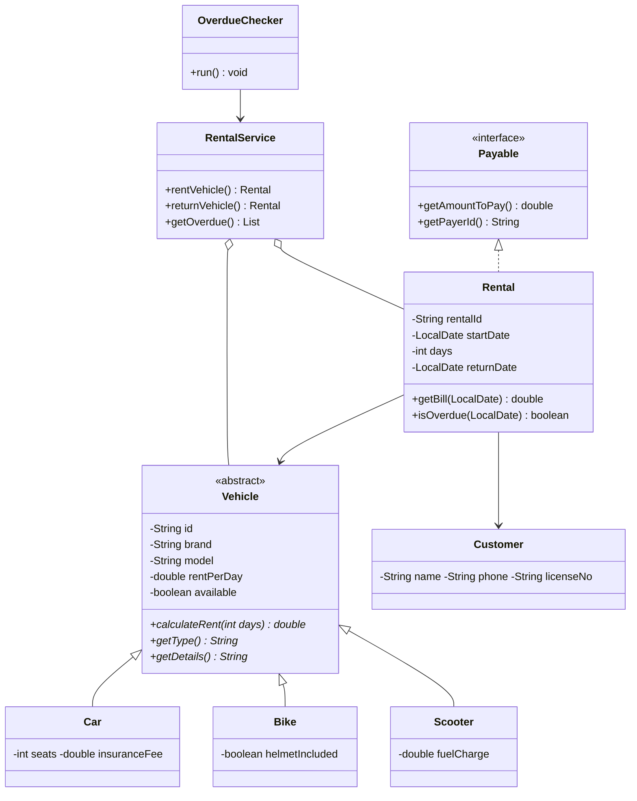

# 🚗 Car / Bike Rental System

A desktop rental management application built in **Java (Swing)** to demonstrate core **Object-Oriented Programming** concepts. Admins can manage a fleet of cars, bikes and scooters, rent them out to customers, track overdue rentals in real time, and generate bills with late fines.

> Built as an OOP course project (CS F213). Data is stored in plain CSV files, so no database setup is needed.

---

## ✨ Features

- **Admin login** (demo credentials below)
- **Fleet management**: add cars, bikes and scooters, and filter the list by type
- **Rent a vehicle**: input validation, a bill preview, and only available vehicles are offered
- **Return a vehicle**: automatic final bill with late-fine calculation
- **Overdue tracking**: a background thread checks every 5 seconds and flags late rentals
- **Rental history** of all completed rentals
- **Persistent storage** in `vehicles.csv` and `rentals.csv`
- **Robust error handling** with custom exceptions and friendly error dialogs

---

## 🛠️ Tech Stack

| | |
|---|---|
| Language | Java 11 or newer |
| GUI | Java Swing |
| Storage | CSV files (`java.nio.file`) |
| Concurrency | `Runnable` thread + `SwingUtilities.invokeLater` |
| Dependencies | None (standard library only) |

---

## 🚀 Getting Started

### Prerequisites
- JDK 11 or newer (`javac -version` to check)

### Run

```bash
git clone https://github.com/<your-username>/<your-repo>.git
cd <your-repo>
javac *.java
java Main
```

### Demo login

| Username | Password |
|---|---|
| `admin` | `admin123` |

On first run, six sample vehicles are created automatically.

---

## 🧪 Quick Demo: See the Overdue Thread Work

1. Open the **Rent a Vehicle** tab.
2. Choose a vehicle, fill in the customer details (phone must be 10 digits).
3. Set **Start date** to 5 days ago and **Number of days** to `2`, then click **Confirm Rental**.
4. Within 5 seconds the status bar turns red: **Overdue rentals: 1**.
5. Go to **Return a Vehicle**, select the rental and return it. The bill includes a late fine.

---

## 💰 Pricing Rules

| Vehicle | Rent calculation |
|---|---|
| **Car** | `days × rate + insurance fee` |
| **Bike** | `days × rate`; 10% discount for 7+ days; `+ Rs.20/day` if helmet not included |
| **Scooter** | `days × rate + fuel charge` |
| **Late fine** (all types) | `late days × daily rate × 0.5` |

---

## 🧱 Project Structure

```
.
├── Main.java                         # Entry point
├── LoginScreen.java                  # Admin login window
├── MainFrame.java                    # Main dashboard (4 tabs)
│
├── Vehicle.java                      # Abstract base class
├── Car.java  Bike.java  Scooter.java # Concrete vehicle types
├── Customer.java                     # Customer details
├── Rental.java                       # A rental transaction (implements Payable)
├── Payable.java                      # Interface
│
├── RentalService.java                # Business logic (no GUI code)
├── FileManager.java                  # CSV read/write
├── OverdueChecker.java               # Background thread
│
├── VehicleNotAvailableException.java # Custom exception
└── InvalidInputException.java        # Custom exception
```

### Class Diagram



---

## 🎓 OOP Concepts Demonstrated

| Concept | Where it is used |
|---|---|
| **Abstraction** | `Vehicle` is abstract with abstract methods `calculateRent`, `getType`, `getDetails` |
| **Inheritance** | `Car`, `Bike` and `Scooter` extend `Vehicle` |
| **Polymorphism** | `Rental.getBaseRent()` calls `vehicle.calculateRent(days)`; the result depends on the actual type. `RentalService` keeps all vehicles in one `List<Vehicle>` |
| **Encapsulation** | Private fields with getters/setters in `Vehicle`, `Customer`, `Rental` |
| **Interfaces** | `Payable` (implemented by `Rental`); `OverdueChecker.Listener` (implemented by `MainFrame`) |
| **Exception handling** | Custom checked exceptions + try/catch around all file I/O and user input |
| **File handling** | `FileManager` reads and writes CSV files |
| **Multithreading** | `OverdueChecker implements Runnable`; GUI updated via `SwingUtilities.invokeLater` |
| **GUI (Swing)** | `LoginScreen`, `MainFrame` with `JTabbedPane`, `JTable`, dialogs |

---

## 📂 Data Files

Created automatically in the folder you run the program from.

**`vehicles.csv`**: `TYPE,id,brand,model,rentPerDay,available,extra`
```
Car,C101,Maruti,Swift,1500.0,true,5;300.0
Bike,B201,Royal Enfield,Classic 350,700.0,true,true
Scooter,S301,Honda,Activa,300.0,true,50.0
```

**`rentals.csv`**: `rentalId,vehicleId,name,phone,license,startDate,days,returnDate,amountPaid`
```
R001,C101,Asha K,9876543210,DL123,2026-11-02,2,2026-11-07,5550.0
```
(`-` in `returnDate` means the rental is still active.)

> Delete both files to reset the app to its sample data.

---

## ✅ Input Validation

- Phone number must be exactly 10 digits
- Name and licence number cannot be empty
- Rental duration must be 1 to 90 days
- Dates must be in `yyyy-MM-dd` format
- A vehicle that is already rented cannot be rented again
- Duplicate vehicle IDs are rejected

---

## 🔮 Future Improvements

- Customer login and self-service booking
- Advance reservations and date-conflict checking
- MySQL / JDBC storage instead of CSV
- PDF receipts
- Revenue reports and charts
- Password hashing and multiple admin accounts

---

## 📸 Screenshots

_Add screenshots here after running the app (e.g. `docs/login.png`, `docs/vehicles.png`)._

---

## 📄 License

This project is for educational purposes. Add a license of your choice (e.g. MIT) before publishing.
